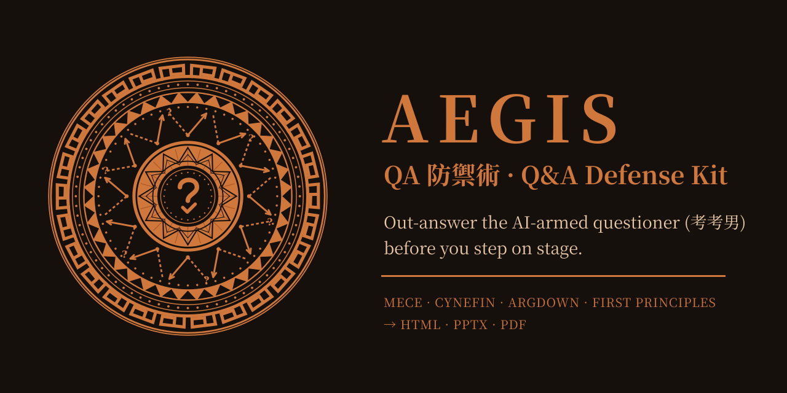
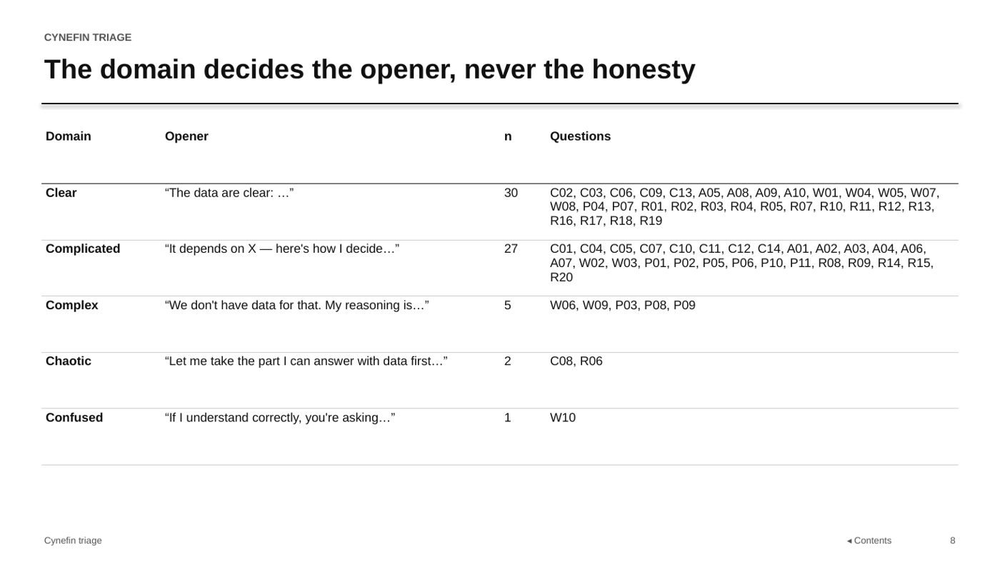
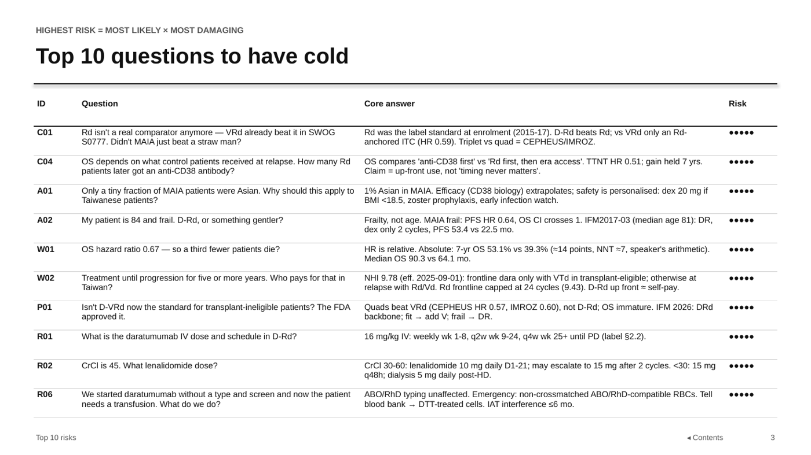
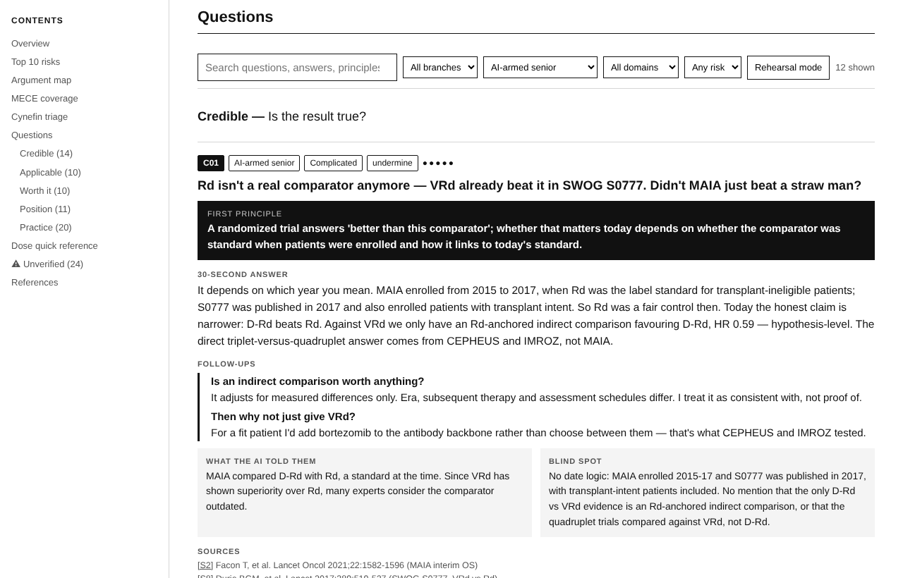
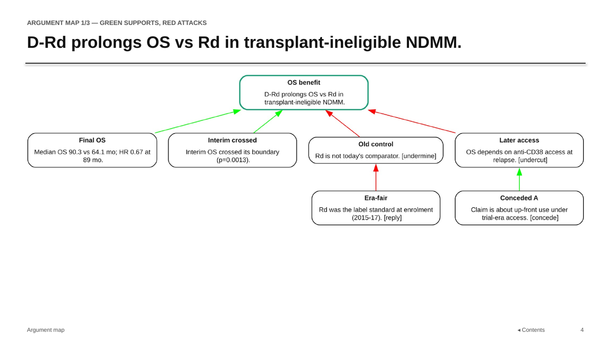
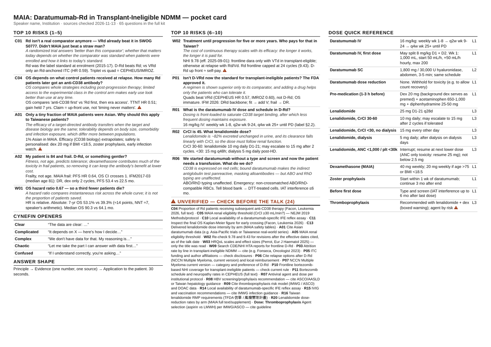

<p align="center">
  
</p>

<h1 align="center">Aegis — Q&amp;A Defense Kit for Medical Presentations · QA 防禦術</h1>

<p align="center">
  <a href="https://github.com/htlin222/qa-aegis/actions/workflows/ci.yml"></a>
  <a href="https://github.com/htlin222/qa-aegis/releases"></a>
  <a href="LICENSE"></a>
  
</p>

<p align="center"><b>Prepare for Q&amp;A after an oncology or hematology talk — and out-answer the AI-armed questioner before you step on stage.</b></p>

**Aegis** is an open-source [Claude skill](SKILL.md) that turns a medical presentation — a journal club, grand rounds, a tumor board talk or a sponsored lecture — into a **Q&A defense kit**: every question the audience is likely to ask, a 30-second answer built from first principles, the follow-up question that comes next, and a source for every number and dose. One YAML file builds an interactive **HTML** kit, a **PowerPoint (PPTX)** deck with a linked table of contents, and a one-page **PDF** pocket card.

**中文：** Aegis（QA 防禦術）是幫醫師準備**演講問答（Q&A）**的 Claude skill，專門對付「**套殼考考男**」——在台下先問完 OpenEvidence、ChatGPT 或 Claude，再上來考講者的提問者。它用 **MECE** 把可能的問題地毯式列出（5 大分支 × 5 種提問者），用 **Cynefin** 決定每題的回答策略，用 **Argdown** 畫出你論點的攻擊點，每個答案都從**第一性原理（底層邏輯）**出發並附上出處；劑量來自仿單，台灣**健保給付規定**註明生效日。適用於腫瘤科、血液科的 journal club、grand rounds、晨會報告與藥廠演講。

## Contents

- [Why Aegis](#why-aegis) · [Who it is for](#who-it-is-for) · [What you get](#what-you-get) · [How it works](#how-it-works)
- [Quick start](#quick-start) · [Worked example: MAIA](#worked-example-maia) · [FAQ](#faq) · [CI and releases](#ci-and-releases) · [Citation](#citation)

## Why Aegis

Q&A is where a talk is won or lost, and it has changed. Many questioners now ask an AI tool the same question during your talk and then check you against its answer. That answer is usually a tidy, guideline-level summary — and it is weakest exactly where a prepared speaker is strongest: trial design, who was excluded, absolute rather than relative benefit, local reimbursement, data newer than the model, and practical dosing.

Aegis prepares you for that room. For each anticipated question it records **what the AI probably told them**, **where that answer is thin**, and **the first principle** that lets you answer better than a recital.

## Who it is for

- Physicians, fellows and residents presenting a **journal club**, **grand rounds**, **tumor board** or **morning report**
- Speakers at **pharma-sponsored lectures** who need comparator, off-label and dosing questions covered
- Clinical pharmacists and educators who teach a regimen and get asked about **dose adjustments**, **premedication** and **lab interference**
- Anyone who wants a structured, auditable way to **anticipate audience questions** for a scientific presentation

## What you get

| Output | What it is |
|---|---|
| `kit.html` | Self-contained page: filter by branch, questioner, Cynefin domain and risk; full-text search; **rehearsal mode** hides answers until you click |
| `kit.pptx` | Cover · linked contents · Top 10 risks · argument maps · MECE coverage · Cynefin triage · one slide per question (script in speaker notes) · dose quick reference · unverified items · references |
| `pocket.pdf` | One A4 page to carry on stage: Top 10 questions with principles and core answers, Cynefin openers, dose table, items still to verify |

<p align="center">
  
  
</p>
<p align="center">
  
  
</p>
<p align="center">
  
</p>

## How it works

| Step | Framework | What it produces |
|---|---|---|
| 1. Map the talk's 3–5 core claims and every way each can be attacked — **rebut** (the conclusion), **undercut** (the inference), **undermine** (a premise) | **Argdown** | Argument maps; each attack seeds questions |
| 2. Sweep the question space across five branches × five questioners, ≥50 questions, with empty cells reported | **MECE** | Coverage grid and question bank |
| 3. Write the answer an AI tool would give and find its blind spot | **AI-shell simulation** | "What the AI told them" / "Blind spot" |
| 4. Classify each question by what kind of answer is honest, and pick the opener | **Cynefin** | Clear · Complicated · Complex · Chaotic · Confused |
| 5. Answer **principle → evidence → application** in 30 seconds, plus follow-ups | **First principles** | Answers that explain *why* the number means what it means |
| 6. Source every number; doses only from the label; reimbursement with its effective date; flag the rest | **Source policy** | ⚠ UNVERIFIED list on every output |

**MECE branches:** *credible* (is it true?) · *applicable* (does it apply to my patient?) · *worth* (absolute benefit, harm, cost) · *position* (comparators, sequencing) · *practice* (dose, schedule, premedication, renal adjustment, prophylaxis, lab interference).
**Questioner personas:** AI-armed senior · statistician · community oncologist · clinical pharmacist · payer.

Read more: [`SKILL.md`](SKILL.md) · [first-principles library](references/first-principles.md) · [Cynefin playbook](references/cynefin-playbook.md) · [personas](references/personas.md) · [source policy](references/source-policy.md) · [YAML schema](references/schema.md)

## Quick start

```bash
git clone https://github.com/htlin222/qa-aegis && cd qa-aegis
pip install -r requirements.txt && python -m playwright install chromium
npm install -g @argdown/cli      # argument maps (optional; falls back to text)
# librsvg (rsvg-convert) renders the maps to PNG for the PPTX

python scripts/validate.py examples/maia/qa.yaml            # coverage grid, schema, unverified list
python scripts/build.py examples/maia/qa.yaml --out out     # → out/kit.html, kit.pptx, pocket.pdf
```

**Install as a Claude skill:** download `qa-aegis-vX.Y.Z.zip` from [Releases](https://github.com/htlin222/qa-aegis/releases) and unzip it into your skills directory (it unpacks to `qa-aegis/` with `SKILL.md` at the root). Then ask Claude something like *"prepare me for Q&A on this slideset"* or *「幫我準備這場演講的 QA 防禦」*.

## Worked example: MAIA

[`examples/maia/`](examples/maia/) — daratumumab-lenalidomide-dexamethasone (D-Rd) in transplant-ineligible newly diagnosed multiple myeloma: **65 questions**, 3 argument maps, 14-row dose reference, sources (PubMed, DailyMed labels, Taiwan NHI rules) checked 2026-11-13. Built outputs are in [`examples/maia/out/`](examples/maia/out/).

> The example demonstrates the method; it is not clinical guidance. Items marked ⚠ UNVERIFIED have not been checked. Verify every number against current labels, guidelines and reimbursement rules before you present.

## FAQ

**How do I prepare for Q&A after a medical presentation?**
List the talk's core claims, then ask of each: is it true, does it apply to my patient, is it worth it, where does it sit among alternatives, and how is it actually given. Aegis automates that sweep, checks coverage, and drafts answers you then verify and rehearse.

**What is an "AI-armed questioner" (套殼考考男)?**
An audience member who asks an AI tool — OpenEvidence, ChatGPT, Claude, Gemini — during the talk and then tests the speaker against its answer. Aegis predicts that answer and prepares the speaker for where it is incomplete.

**Do I need OpenEvidence or another paid tool?**
No. The skill generates the likely AI answer itself. You can paste a real one into `ai_answer` if you have it.

**Is it only for oncology and hematology?**
The examples and principle library are oncology/hematology, but the branches, personas, Cynefin triage and build pipeline work for any evidence-based talk.

**Can I trust the doses and numbers?**
Only after you check them. The source policy requires every number to cite a source read in the session and every dose to come from a label or protocol; anything unchecked is flagged ⚠ UNVERIFIED on all three outputs.

**Does the repository include NCCN text or company slides?**
No. Sources are cited by reference only.

## CI and releases

- **CI** ([`ci.yml`](.github/workflows/ci.yml)) on every push and pull request: strict coverage validation → build → output checks (every question has a slide and an HTML card, contents links resolve, the pocket card is exactly one page) → package; outputs are uploaded as a workflow artifact.
- **Release** ([`release.yml`](.github/workflows/release.yml)) on a `vX.Y.Z` tag: checks the tag against `VERSION` and `CHANGELOG.md`, rebuilds, and publishes a GitHub Release with the installable skill zip and the MAIA example `.pptx`, `.html` and `.pdf`.

```bash
echo 0.2.0 > VERSION   # then add "## [0.2.0] - YYYY-MM-DD" to CHANGELOG.md
git commit -am "Release v0.2.0" && git tag v0.2.0 && git push origin develope v0.2.0
```

<details>
<summary>Repository layout</summary>

```
SKILL.md                 skill workflow
references/              MECE branches, personas, Cynefin playbook, first-principles library,
                         Argdown guide, source policy, YAML schema
scripts/build.py         YAML → HTML / PPTX / PDF
scripts/validate.py      schema, coverage grid, unverified list
scripts/check_outputs.py CI smoke test of built outputs
scripts/package.py       skill zip + release notes from CHANGELOG
templates/               HTML and pocket-card templates
assets/                  logo (SVG/PNG), favicon, social preview, screenshots, generator
examples/maia/           worked example (MAIA, D-Rd)
.github/workflows/       ci.yml, release.yml
```
</details>

## Citation

If Aegis helps your teaching, cite it with the metadata in [`CITATION.cff`](CITATION.cff) (GitHub shows a "Cite this repository" button).

## License

[MIT](LICENSE). The logo is an original design in the manner of an Attic red-figure cup tondo.
